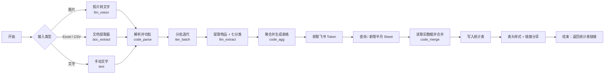

# 心愿统计表 · Wish Statistics Workflow

> 一个基于 **Dify** 的自动化「心愿 / 许愿留言」统计工作流：把分散在**图片、文字、Excel 表格**里的心愿，自动识别、归入七大类，并汇总写入一张固定的飞书电子表格（每半月一个 Sheet），最后返回可分享的统计表链接。全程匿名可用。

## ✨ 功能特性

- **三种输入方式**：上传心愿照片、粘贴/输入文字、导入 Excel/CSV 文件。
- **图片自动识别**：照片先经视觉模型转成文字描述，再提取其中的物品。
- **文字自动分类**：每条留言提取商品名，并归入唯一的七分类。
- **Excel 直接导入**：自动识别表格中的「心愿描述」列，批量解析。
- **七分类汇总**：自动生成横向并列的「品类 + 许愿人次」二维表格。
- **按半月归档**：按日期自动归入上半月（1–15 日）或下半月（16 日–月末）Sheet。
- **增量合并**：写入前先读取已有数据，与新数据累加，不覆盖历史记录。
- **自动分享**：设置表格链接分享，并返回可直接打开的统计表 URL。
- **匿名可用**：只统计物品与次数，不记录留言者身份。

## 🗂️ 七分类说明

| 分类 | 覆盖范围（示例） |
| --- | --- |
| 洗护用品 | 洗发、沐浴、牙膏、身体乳、护手霜、卫生巾、一次性内裤、清洁剂 |
| 鞋服 | 鞋、帽、衣、裤、袜、围巾、普通内裤、防晒衣帽 |
| 食品保健 | 零食、生鲜、饮料、保健品、膏药贴布 |
| 美妆护肤 | 面霜、眼霜、精华、彩妆、卸妆、涂脸的防晒 |
| 百货 | 厨具、收纳、家居杂货、清洁工具 |
| 数码家电 | 大小家电、电子数码 |
| 箱包 | 背包、行李箱、包包、钱包 |

## 🔄 工作流程



## 📥 输入参数

| 参数 | 类型 | 是否必填 | 说明 |
| --- | --- | --- | --- |
| `text` 手动文字 | 段落文本 | 否 | 一条或多条心愿留言，每行一条 |
| `photo` 心愿照片 | 图片 | 否 | 每次 1 张，支持本地上传或图片 URL |
| `file` 星云导出 Excel | 文件 | 否 | 支持 `.xlsx` / `.xls` / `.csv` |
| `period` 日期 | 文本 | 否 | 如 `2026-09-20` 或 `9.16-9.30`；留空按当天 |

## 📤 输出结果

| 字段 | 说明 |
| --- | --- |
| `table_url` | 统计表分享链接 |
| `sheet_title` | 本次归档的半周期名，如 `9.16-9.30` |
| `summary` | 汇总摘要：周期、物品种类数、总许愿人次、统计表链接 |

生成的表格为 14 列（`A1:N1`）：七个分类各占「分类名 + 许愿人次」两列，每行按该分类的许愿人次从高到低排列。

## 🚀 快速开始

### 1. 导入 Dify

1. 登录 Dify，选择 **创建应用 / Create App**。
2. 选择 **导入 DSL / Import DSL File**，上传本仓库的 `心愿统计表.yml`。
3. 导入后，在应用的 **环境变量** 中补填下面的值。

### 2. 配置环境变量

| 变量 | 说明 | 获取方式 |
| --- | --- | --- |
| `FEISHU_APP_ID` | 飞书自建应用 App ID | 飞书开放平台 → 自建应用 → 凭证与基础信息 |
| `FEISHU_APP_SECRET` | 飞书自建应用 App Secret | 同上（Secret 需点击查看 / 重置） |
| `FEISHU_SPREADSHEET_TOKEN` | 目标电子表格 ID | 打开飞书表格，URL 中 `sheets/` 后面的那串字符 |

> 该飞书自建应用需拥有目标电子表格的读写权限：把应用（机器人）添加为文档协作者，并在开放平台开启电子表格读写、云文档权限设置等 API 权限。

### 3. 运行

发布应用后，可通过 Web 界面或 API 传入图片 / 文字 / Excel，运行后即可得到统计表链接。

## 💡 使用场景示例

**场景 1：直播 / 短视频心愿征集**
运营在评论区收集观众许愿，把留言导出 Excel（例如星云导出）后直接导入 → 自动生成七分类需求统计表，用于选品备货。

**场景 2：私域社群许愿清单**
社群成员发「想要黑色半掌袜子」「COACH 蔻驰 单肩斜挎包 棕色 中号」等消息，复制粘贴或截图上传 → 自动分类计数。

**场景 3：节日礼物清单**
生日、婚礼、年会等场景，大家上传心愿照片和文字 → 自动汇总成一份七分类清单，方便统一采购。

**场景 4：电商选品调研**
把用户留言中的「想买什么」结构化，按品类和热度排序，快速定位高需求商品。

示例输出 `summary`：

```
半月周期：9.16-9.30
物品种类：12
总许愿人次：35
统计表：https://my.feishu.cn/sheets/xxx
```

## 📁 目录结构

```
.
├── 心愿统计表.yml   # Dify 工作流 DSL（凭据已用环境变量占位）
├── README.md
└── .gitignore
```

## 🧰 技术栈

- 平台：Dify（Workflow 工作流）
- 视觉模型：`deepseek-v4-flash-vision-exp`（照片转文字）
- 分类模型：`deepseek-v4-flash`（物品提取与七分类）
- 存储：飞书电子表格（飞书开放平台 API）

## 🔐 安全说明

- 本仓库 DSL 中的飞书 App ID、App Secret、表格 ID 均已用环境变量占位，公开仓库不包含真实凭据。
- 导入 Dify 后请在应用环境变量中填写真实值，不要把 Secret 提交到仓库。
- 若曾将含明文 Secret 的旧版本文件外传，请到飞书开放平台重置 App Secret。

---

*README 依据该工作流的实际节点结构整理生成，具体实现以 `心愿统计表.yml` 为准。*